# StillBrief · 息间

**Let AI triage your notifications, so you can actually stay in flow.**

When we're deep in code, reading a paper, or trying to finish a draft, we rarely check our phones because something urgent actually happened. We check *just in case*. And we all know how that ends: one glance at the lock screen turns into opening an app, scrolling a feed, and losing twenty minutes of focus.

**StillBrief** acts as a quiet buffer between your phone and your attention. **Your phone keeps catching notifications during focus sessions, AI reviews them in batches at an interval you set, and you get pinged when there's something worth checking.** If it's all noise, your phone stays silent.

[Download for Android](https://github.com/HITzengyz/StillBrief/releases/latest) · [Quick start](#quick-start) · [中文](README.md)

## How it works in practice

You don't need to change how people reach you. Texts, missed calls, emails, WeChat, Slack, or whatever else lands in your Android notification shade during a focus session gets quietly collected in the background:

### One brief instead of twenty pings

Say you lock in for a 35-minute session. During that time, you get a dozen casual group chat messages, a routine system status update, and a colleague asking to confirm a meeting time. The reminder you're looking for is: *"Alex asks to confirm tomorrow afternoon's meeting time."* If nothing worth checking came in, you get nothing at all.

<p>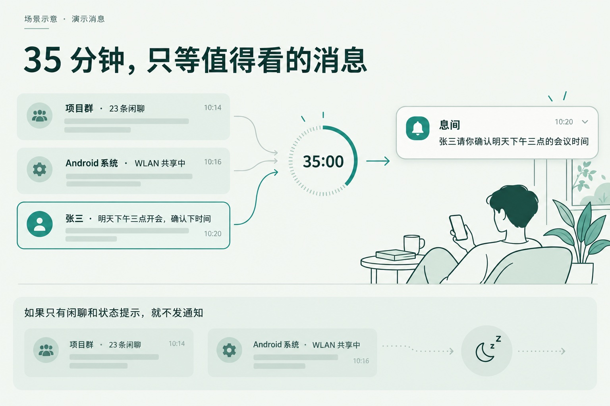</p>

*Illustrated scenario with sample messages. Labels are in Chinese.*

**The same example in the app.** These are actual Android emulator screenshots, using demo notifications and fixed model responses.

<p>
  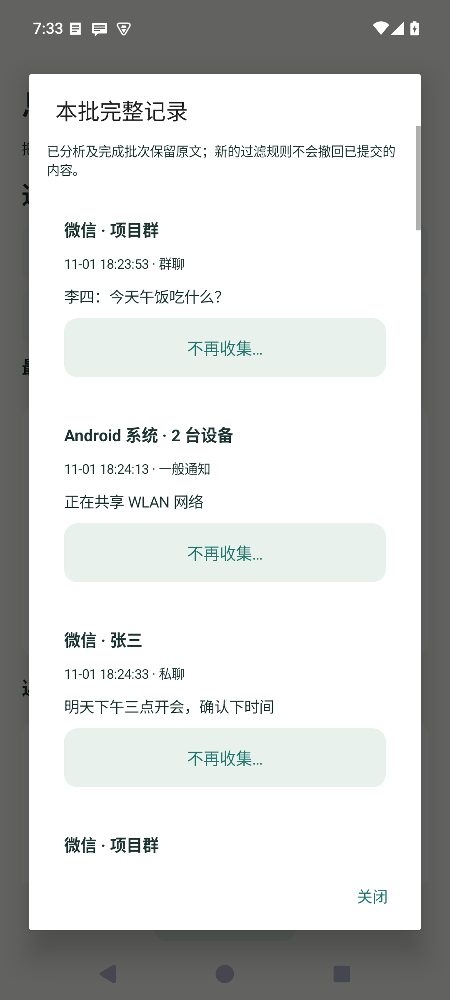
  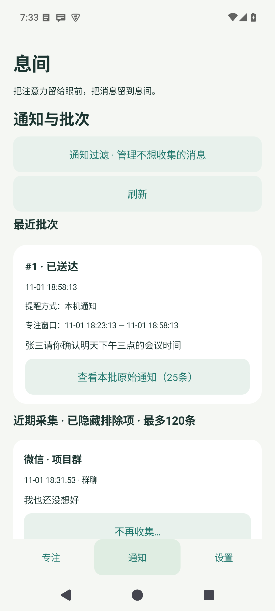
  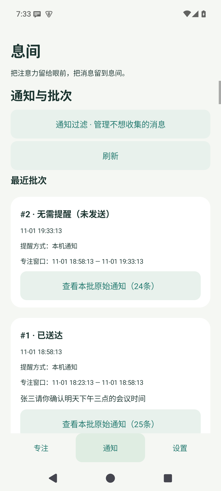
</p>

Left to right: the original messages, the meeting summary, and a separate noise-only round marked “No reminder needed (not sent)”.

### Keep the phone out of reach

Pair StillBrief with Android's Do Not Disturb so only its summaries can break through. Or better yet, leave your phone across the room and route summaries to **Feishu** on your desktop.

<p>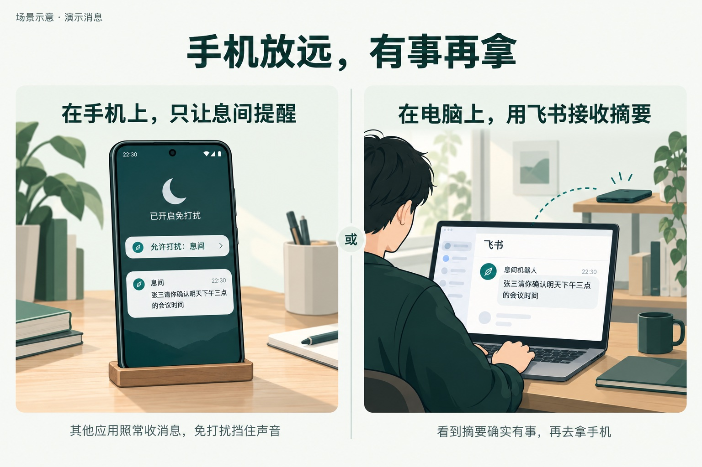</p>

*Choose on-device notifications or a Feishu bot to suit your workspace.*

<p>
  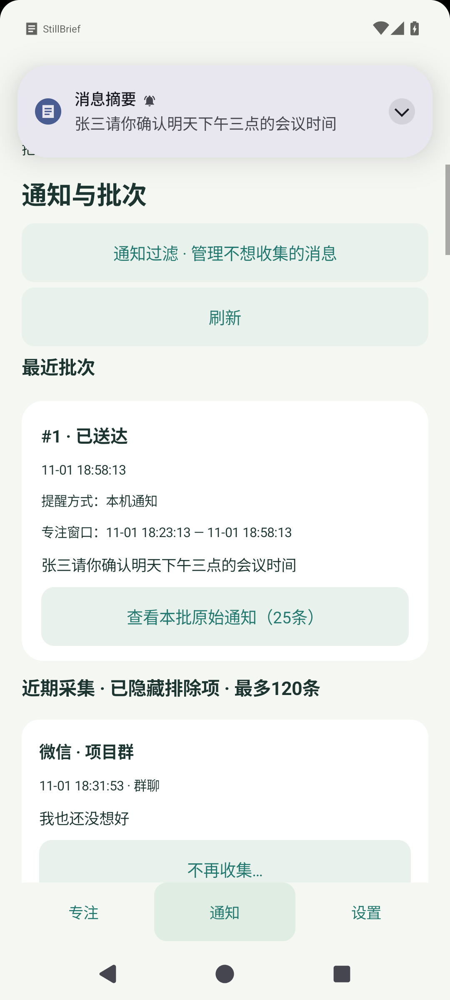
  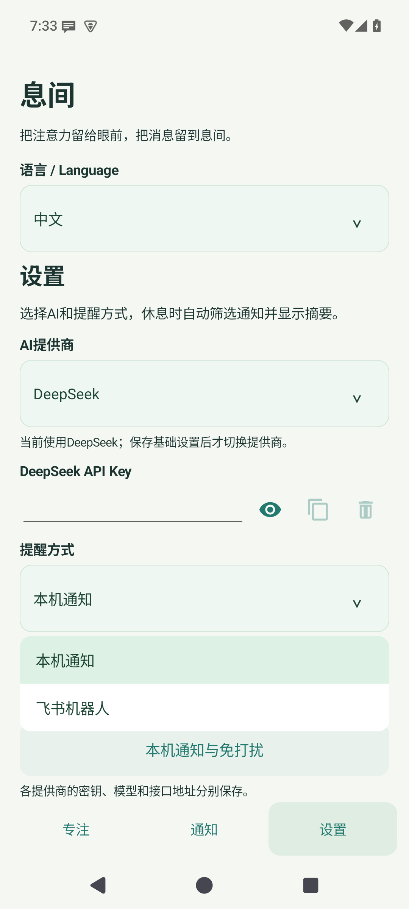
  
</p>

The actual Android reminder banner, destination picker, and DND setup page. Choose where summaries should appear here.

A mockup of the same summary arriving in desktop Feishu:

<p>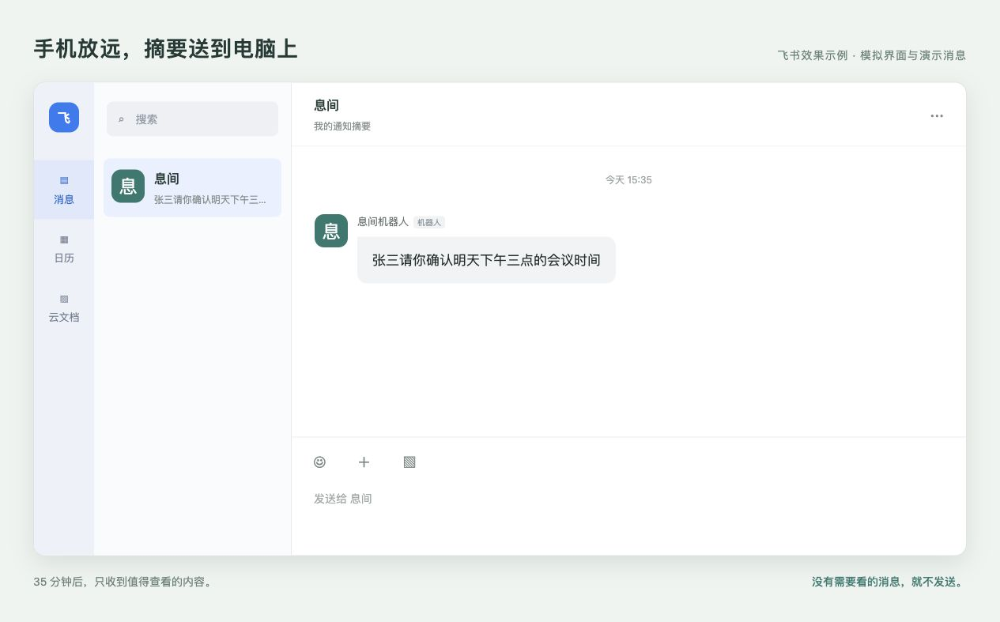</p>

### Match your workflow

Run a **Single** timer when you just need to get through one paper or task, or put it on **Loop** for all-day deep work with automatic check-ins every 30 or 45 minutes.

<p>
  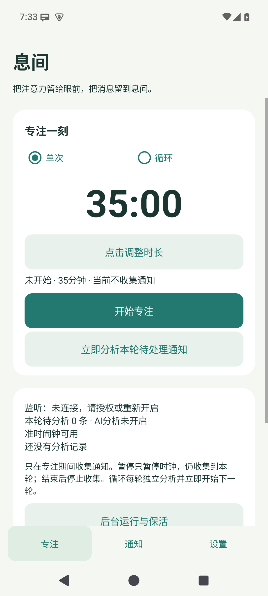
  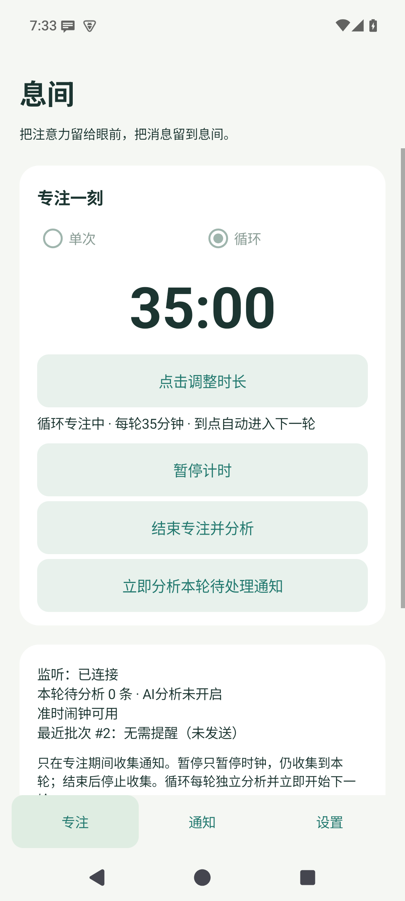
</p>

*Left: a 35-minute Single session ready to start. Right: Loop has entered its next 35-minute round.*

### Bring your own key

Plug in your own OpenAI, Anthropic, or DeepSeek API key. Requests go straight to the endpoint you configure; you choose the model and pay your provider for API usage.

<p>
  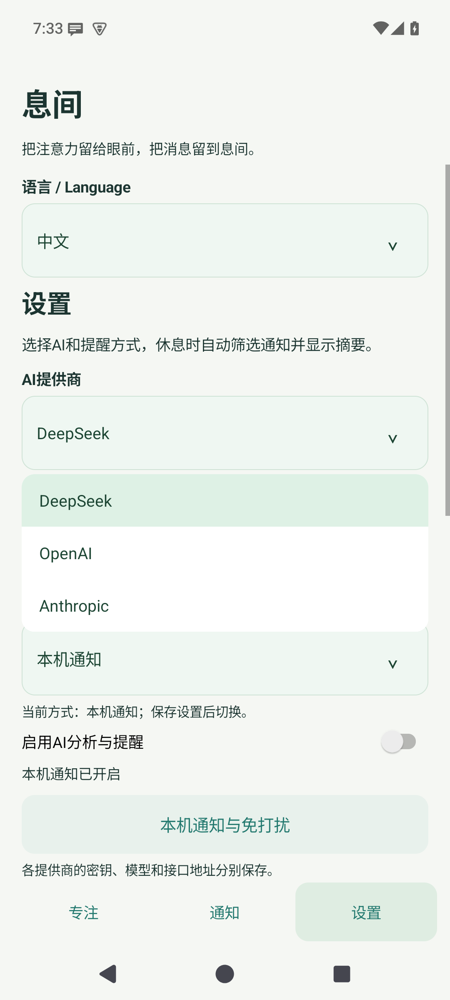
</p>

*Actual app screen: choose a provider, then enter its API key.*


## Quick start

Because Android is aggressive about killing background apps, taking two minutes to set up permissions properly will save you headaches later.

### 1. Install and lock in background permissions

Grab the latest **StillBrief APK** from [Releases](https://github.com/HITzengyz/StillBrief/releases/latest) (requires Android 8.0+).

Head to **Settings → Background operation**:

1. Grant **Notification access**, then check the home screen to make sure the listener shows as connected.
2. Follow the on-screen prompts to enable **Auto-start** and set battery usage to **Unrestricted** so the OS doesn't put StillBrief to sleep.
3. Grant **Exact alarms** permission so your focus timer can trigger analysis in the background when time's up.

*(Tip: You can switch the UI to **English** right at the top of Settings under **语言 / Language**. The screenshots below show the Chinese interface.)*

### 2. Hook up your AI provider

In **Settings**:

1. Pick your **AI provider** and paste in your **API Key** (start with the default model and endpoint).
2. Set the reminder destination to **On-device notification**.
3. Toggle on **AI analysis and reminders** and hit **Save settings**.
4. Open **Local notifications and Do Not Disturb**, grant notification permissions, and tap **Send test notification** to make sure alerts come through.

<p>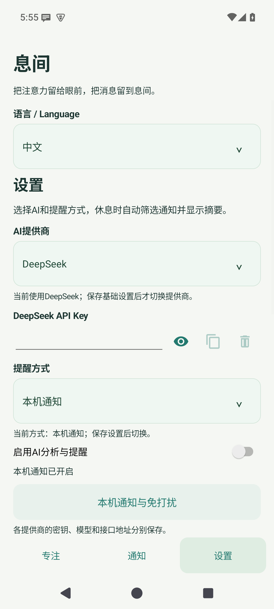</p>

### 3. Let only StillBrief bypass Do Not Disturb

Here is the trick that makes the whole setup work: **leave notifications turned ON for your messaging apps** (so StillBrief can read them in the tray), and **use system Do Not Disturb to silence everything except StillBrief.**

From **Local notifications and Do Not Disturb**, jump into your system DND settings:

- Turn **Do Not Disturb** on.
- Under **Allowed interruptions → Apps**, add **StillBrief** and remove everything else.
- Turn off call and SMS exceptions too if you want StillBrief to screen those as well.
- With DND active, hop back to StillBrief and tap **Send test notification** to verify it breaks through.

<p>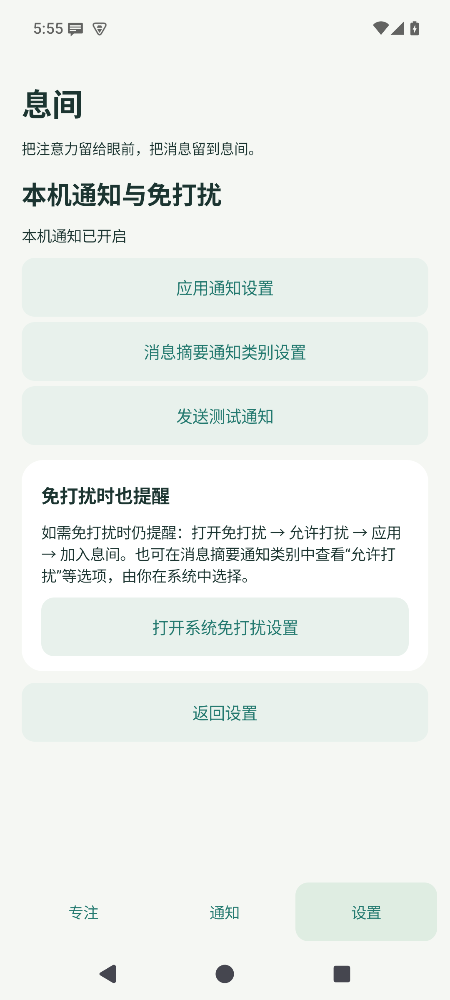</p>

### 4. Set a timer and put your phone down

On the **Focus** tab, tap the timer, then drag the dial or tap a preset (**15, 25, 35, 45, or 60 minutes**—or tap the center digits to type a custom time).

Choose **Single** or **Auto-repeat** at the top right of the focus card, then hit **Start focus**. You can switch modes mid-session without resetting the remaining time:

| Mode | What happens when time's up | Best for |
| --- | --- | --- |
| **Single** | Stops the timer and summarizes the round | Reading a paper, finishing a specific ticket |
| **Loop** | Starts the next round immediately while analyzing the previous one in the background | Full-day work sessions with periodic check-ins |

Flip your phone face down. If nothing pops up, you're good to keep going.

<p>
  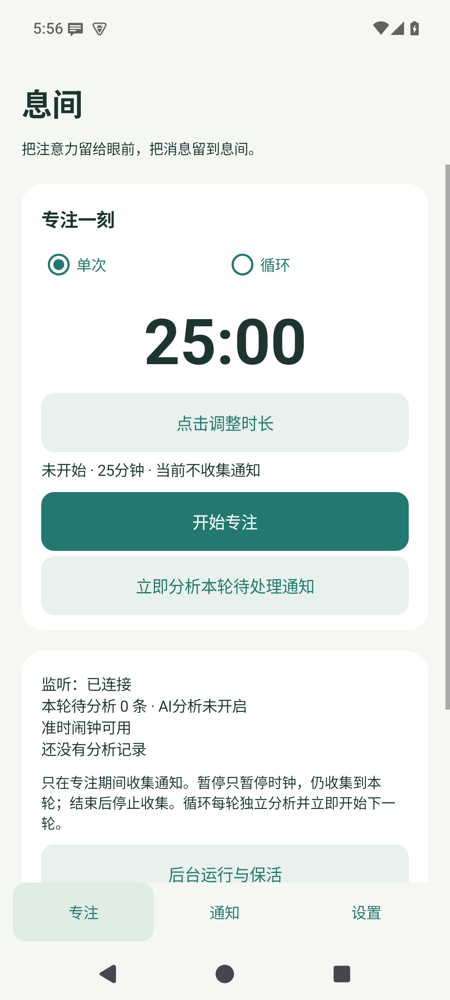
  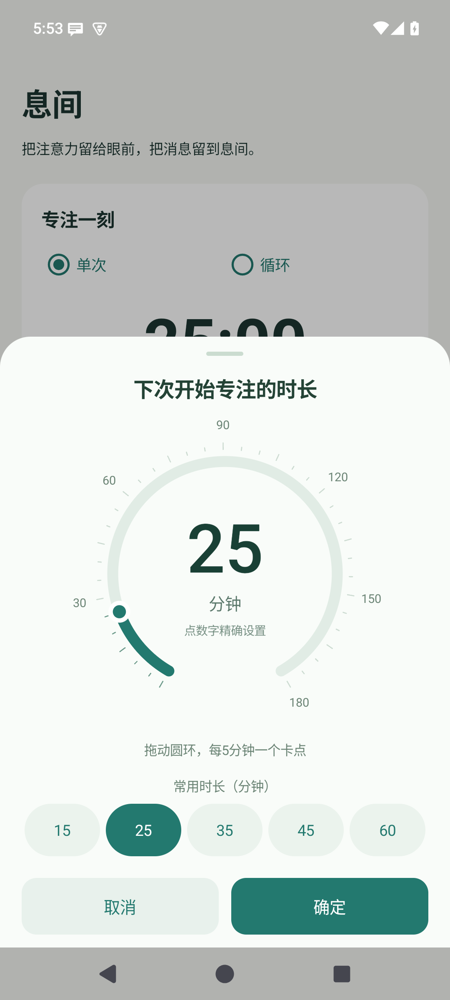
</p>

## Control focus from your home screen

Long-press an empty area of your home screen, find **StillBrief** in the widget picker, and add **2×1 Quick focus**, the **4×1 bar**, or the **2×2 tile**.

**2×1 Quick focus** starts a session with one tap on **25, 35, or 45** minutes. Once running, tap **Pause**, then **Resume** when ready. It follows the Single or Loop mode selected in the app. Every loop uses the chosen preset without changing your saved default duration.

While running, widgets show the scheduled check time, such as **Check 11:35**. Pausing shows the remaining duration; each new loop updates the check time. The app keeps its live countdown.

Buttons work directly, without a confirmation dialog or opening the app:

- **Analyze** reviews pending messages from this round while the timer and loop keep going.
- **End & analyze** ends this round, analyzes the remaining messages, and stops the loop.
- When idle, tap **Start focus**; when paused, tap **Resume**. Tap the time to open Focus and change the duration or mode.

Analyze is disabled when there is nothing pending or an analysis is already running. All three widgets control the same focus session; analysis controls are on the 4×1 bar and 2×2 tile.

<p>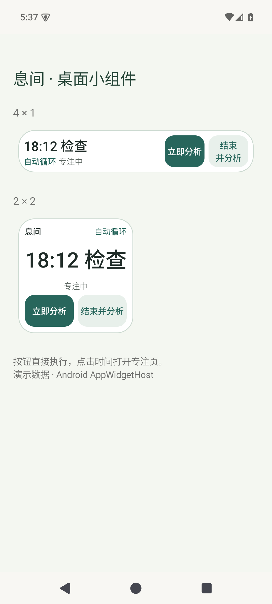</p>

*Actual controls rendered in an Android widget host with demonstration state.*

## Tweaking it to your taste

**Light, dark, or automatic**
Choose **Light**, **Dark**, or **System default** under **Settings → Appearance**. The default follows your phone, including its scheduled dark theme. All three home-screen widgets use this setting too. Switching appearance keeps your timer and unsaved settings intact.

**Muting noisy apps and status updates**

You don't need an LLM burning tokens on repetitive Wi-Fi status alerts or music player controls. On the **Notifications** tab, tap **Stop collecting…** under any message to block that exact text, that specific notification channel, or the entire app. You can manage or undo these anytime under **Settings → Notification filters**.

**Getting summaries on your desktop**

If you want your phone completely out of sight, switch the reminder method to **Feishu bot** and paste in a group bot **Webhook** (**Feishu group settings → Group bots → Add custom bot**; if you use signature verification, drop the secret into StillBrief's **Advanced settings**). Now your summaries show up right on your computer screen.

**Verification codes without the wait**
Choose **Feishu bot** as the reminder destination, enable **Forward verification codes immediately**, fill in the Webhook and save. Explicitly marked verification codes go straight to Feishu without waiting for the focus timer or calling AI, even outside a focus session. Switching to on-device notifications disables this route. Delivery records and failures appear on the Notifications tab.

**Pausing or checking in early**

- **Pause timer:** Stepping away for coffee? Pause the clock while StillBrief keeps catching notifications for the current round.
- **End focus and analyze:** Wrap up early, get your summary, and stop the loop.
- **Analyze this round's pending notifications:** Need to check if an expected message arrived without breaking your timer? Run a quick mid-round summary while the countdown keeps rolling.

## Feedback & building from source

Found a case where the AI missed an urgent text or flagged spam as important? Open an [Issue](https://github.com/HITzengyz/StillBrief/issues)—real-world edge cases help a ton with tuning, and feature ideas are always welcome.

<details>
<summary>Build from source</summary>

Requires JDK 17 and Android SDK 35:

```sh
export JAVA_HOME=/path/to/jdk-17
export ANDROID_HOME=/path/to/android-sdk
./gradlew testDebugUnitTest lintDebug assembleDebug
# With a device or emulator connected
./gradlew connectedDebugAndroidTest
```

The debug APK lands in `app/build/outputs/apk/debug/app-debug.apk`. Check [release signing](docs/releasing.md) for production builds.

</details>

[Privacy](PRIVACY.en.md) · [MIT License](LICENSE) · [Third-party notices](THIRD_PARTY_NOTICES)
