# 息间 · StillBrief

**把通知交给 AI 先过一遍，你只管安心做手头的事。**

写代码、看论文或者赶进度的时候，手机放在一旁其实挺折磨人的——倒不是真有什么十万火急的事，就是怕万一漏了哪条重要消息。结果往往是：拿起来看一眼通知，顺手点进群聊或刷了两下信息流，半小时就这么没了。

做 **息间（StillBrief）** 的初衷很简单：**让手机照常收消息，但先别吵我。每隔一段时间，让 AI 帮我把攒下的通知快速过一遍。** 有值得查看的消息，整理成摘要提醒我；如果全是群聊水群、促销推送和系统提示，那就什么都别发，让我继续安静待着。

[下载 Android 版](https://github.com/HITzengyz/StillBrief/releases/latest) · [上手指南](#上手指南) · [English](README.en.md)

## 它是怎么帮我找回注意力的？

你不需要改变原有的聊天习惯。微信、QQ、短信、邮件和未接来电，只要在专注期间进了安卓通知栏，息间就能在后台默默收集：

### 没事绝不打扰

假设你定了一个 35 分钟的专注计时，期间手机收到了几十条群聊闲聊、几条系统状态提示，还有导师/同事发来的一句“明天下午三点开会确认下时间”。倒计时结束时，你想收到的就是一条提醒：**“张三请你确认明天下午三点的会议时间”**。至于如果这 35 分钟里全是废话？那手机就干脆利落地保持安静。

<p>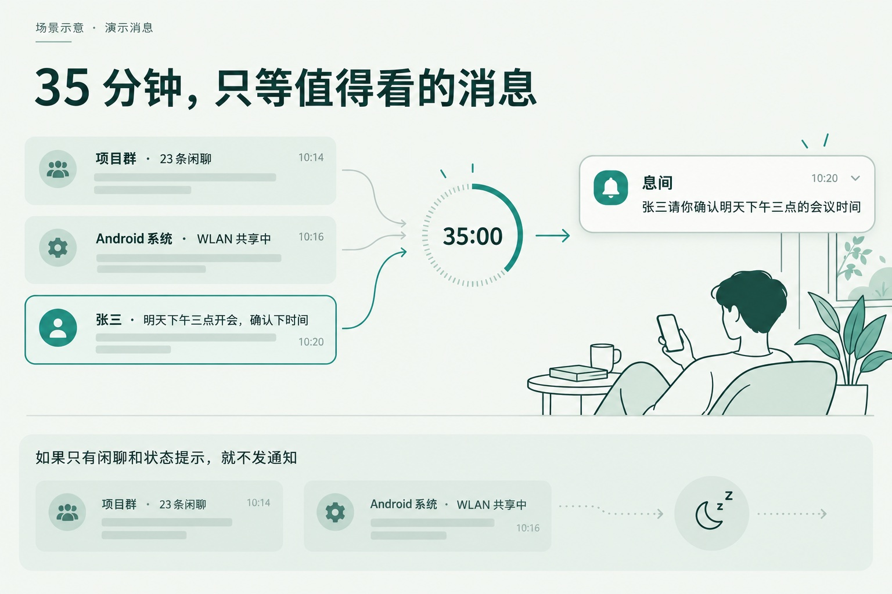</p>

*场景示意，图中消息为演示内容。*

**同一个例子，在软件里长这样。** 以下为 Android 模拟器中的真实界面，通知和模型返回使用固定演示数据。

<p>
  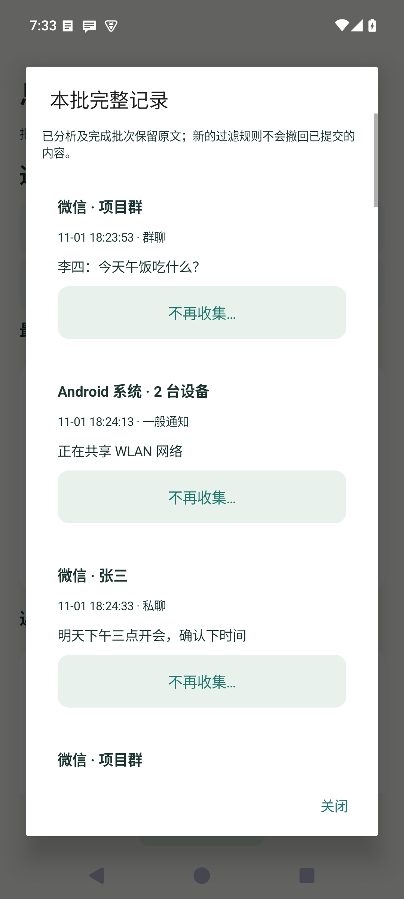
  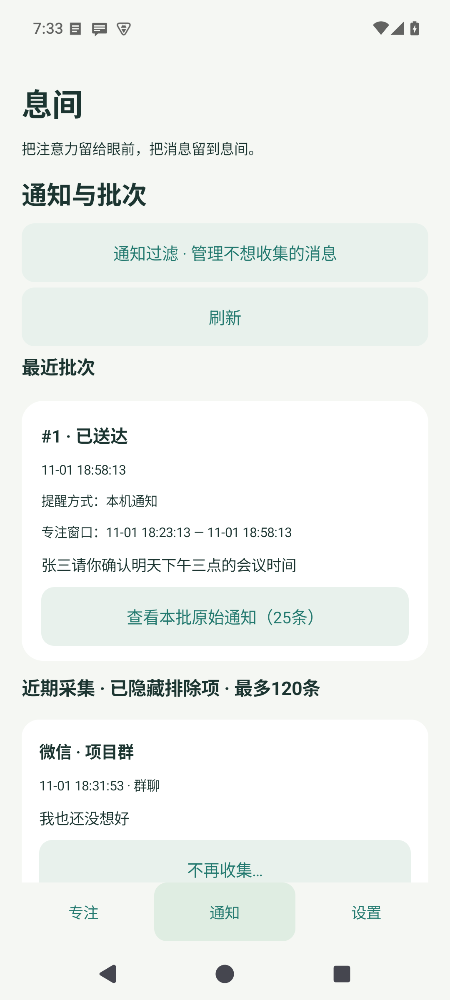
  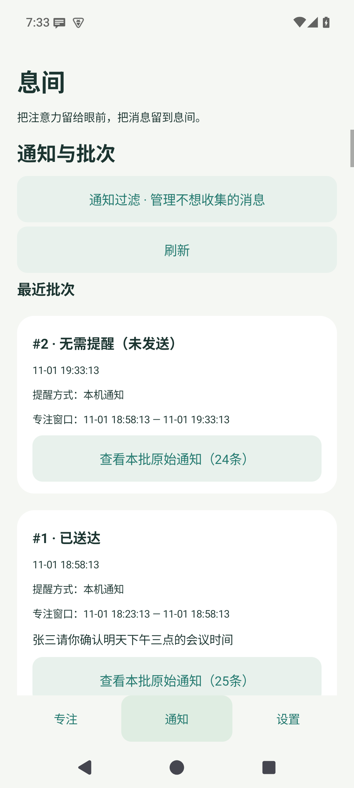
</p>

从左到右：本轮原始通知、会议摘要、另一轮只有闲聊时的“无需提醒（未发送）”。

### 把手机彻底放远

你可以配合系统的“免打扰”模式，只给息间留一个白名单；或者更彻底一点——把手机扔到够不着的地方，让它通过**飞书机器人**把摘要推到你正在工作的电脑上。看到电脑弹窗确实有事，再去拿手机。

<p>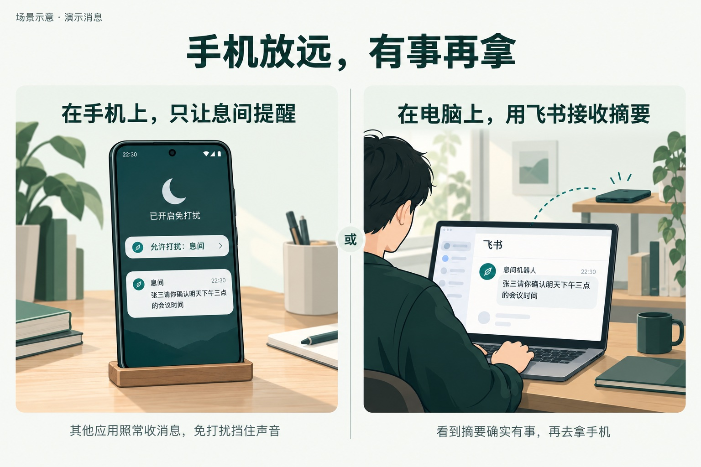</p>

*选本机通知，或选飞书机器人，按你的工作习惯来。*

<p>
  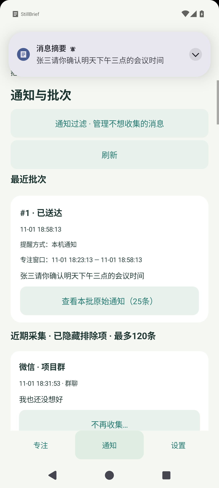
  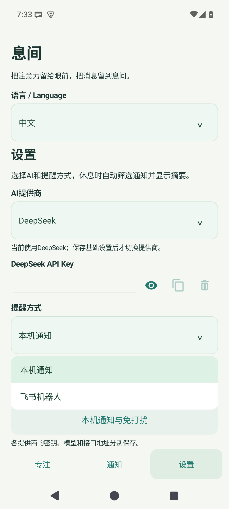
  
</p>

实际弹出的系统摘要、本机／飞书选择菜单，以及免打扰设置入口。在这里决定摘要发到哪里。

同一条摘要发到电脑飞书后，大致是这样的效果（模拟界面）：

<p>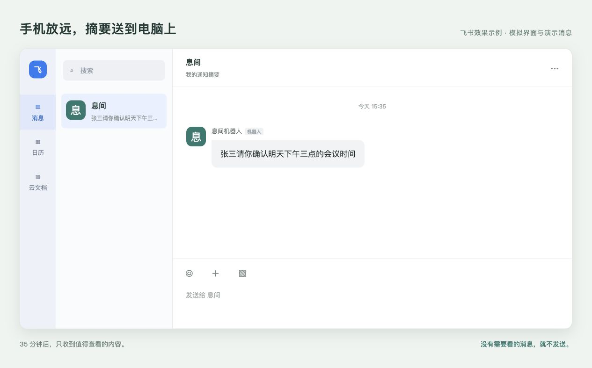</p>

### 单次冲刺，或是全天巡航

只想静下心读完手头这篇论文，用**单次模式**；如果是整块的工作时段，开**循环模式**，让它每隔半小时或四十五分钟替你巡检一次消息。

<p>
  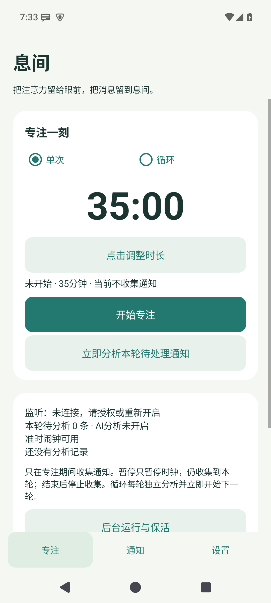
  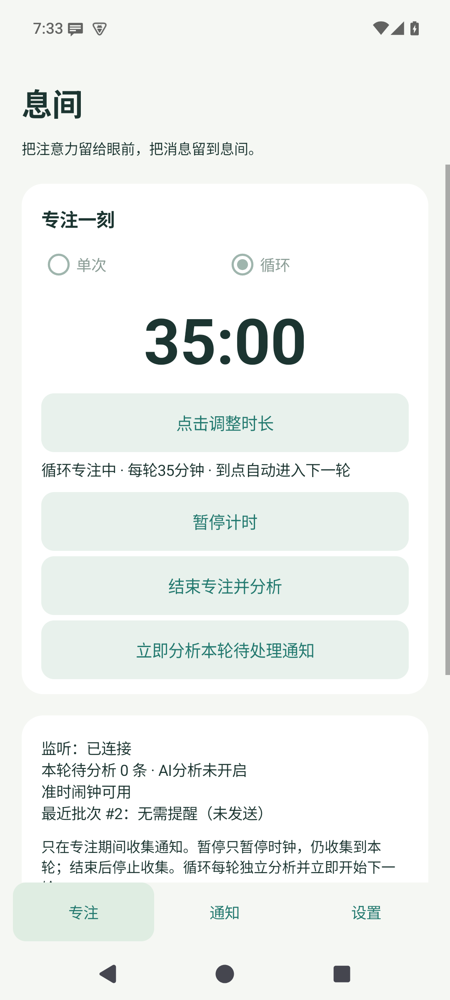
</p>

*左：单次模式，准备开始 35 分钟专注。右：循环模式，已经进入下一轮 35 分钟。*

### 自带 Key，丰俭由人

直接接入你自己的 OpenAI、Anthropic 或 DeepSeek API Key，请求直接发到你配置的接口，成本和模型自己掌控。

<p>
  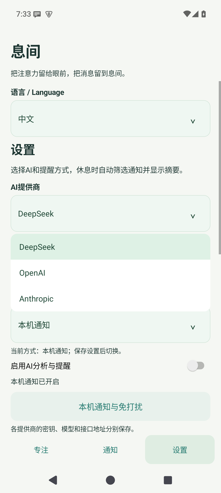
</p>

*应用实际界面：先选提供商，再填对应的 API Key。*


## 上手指南

因为安卓系统对后台和通知权限管得比较严，初次使用需要花两分钟把通路打通。

### 第一步：给齐权限，让它能安稳待在后台

从 [Releases](https://github.com/HITzengyz/StillBrief/releases/latest) 下载最新的 **StillBrief-2.0.apk** 安装（支持 Android 8.0 及以上）。

打开软件，进入 **设置 → 后台运行与保活**：

1. 开启**通知读取权限**，返回首页看到状态变成“监听：已连接”，说明它已经能正常读取通知栏了。
2. 顺手按页面提示把**自启动**打开，并把省电策略设为**无限制**，免得锁屏后被系统清掉后台。
3. 授予定时器的**准时闹钟权限**，让倒计时结束时能在后台触发汇总。

### 第二步：接上你的大模型

进入 **设置** 页面，把 AI 跑起来：

1. 选好你常用的 **AI 提供商**，填进对应的 **API Key**（模型和接口地址先用默认的就行）。
2. **提醒方式**先选 **本机通知**。
3. 打开 **启用 AI 分析与提醒** 的开关，点一下**保存设置**。
4. 点进 **本机通知与免打扰**，给息间发送通知的权限，然后点一下**发送测试通知**——能看到通知，这步就通了。

<p>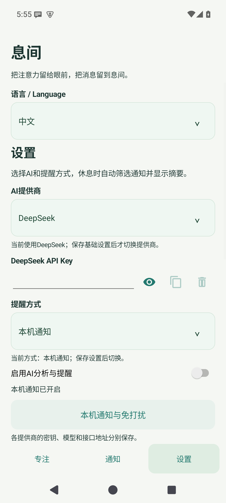</p>

### 第三步：配合系统“免打扰”，屏蔽其它噪音

这是体验最核心的一步：**我们要让微信、短信照常发通知（这样息间才能抓得到），但不能让它们叮咚乱响，只允许息间出声。**

在 **本机通知与免打扰** 页面里，点击 **打开系统免打扰设置**：

- 打开系统的**免打扰**模式。
- 找到**允许打扰的应用（例外列表）**，把**息间**加进去，其它应用全部清掉。
- 如果不想被普通电话和短信直接打断，把来电和短信的免打扰例外也关掉。
- 设好后别关免打扰，回到息间再点一次**发送测试通知**，确认它能穿透免打扰提醒你。

*（注：不同品牌手机的菜单名字不太一样，有些手机也可以直接在系统的“息间 → 通知管理 → 消息摘要”类别里打开“忽略免打扰”。切记不要去关微信本身的通知开关，否则消息进不了通知栏，息间也就成瞎子了。）*

<p>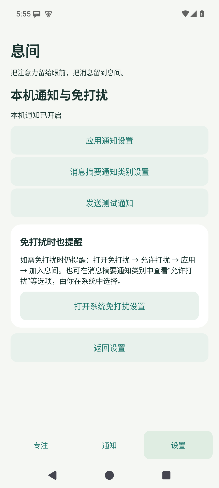</p>

### 第四步：定个时间，把手机扣在桌上

回到**专注**页面，点一下时间，拨动圆环定个时长（可以直接点 **15、25、35、45、60 分钟** 的快捷档位，或者点中间的数字手输）。

在专注卡片右上角选择**单次**或**自动循环**，按下**开始专注**。计时途中也能切换模式，剩余时间不会重置：

| 模式 | 倒计时结束后 | 适用场景 |
| --- | --- | --- |
| **单次** | 停止计时，汇总分析这一轮的消息 | 啃完一篇硬核论文、写完一个独立模块 |
| **循环** | 立即开启下一轮，同时在后台分析本轮消息 | 一整天泡在实验室或工位，每隔半小时自动巡检一次 |

现在可以把手机扣过去放一边了。没动静就是最好的消息。

<p>
  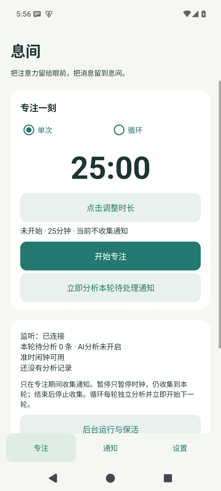
  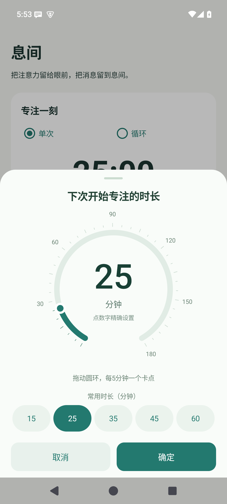
</p>

## 顺手的小功能

**把烦人的常驻通知拉黑**

像系统自带的“WLAN 已连接”、后台步数统计或者音乐播放器的切歌通知，没必要浪费 Token 让 AI 去看。直接在**通知**页点开那条消息下面的**不再收集…**，你可以选择精准屏蔽这句话、屏蔽这一个通知渠道，或者干脆拉黑整个 App。如果哪天反悔了，去 **设置 → 通知过滤** 里删掉规则就行。

**把摘要推到电脑飞书上**

如果你工作时完全不想碰手机，强烈建议把提醒方式改成**飞书机器人**。在飞书准备一个只有你自己的、支持自定义机器人的群，通过 **群设置 → 群机器人 → 添加自定义机器人** 拿到 Webhook 填进息间（如果开了签名校验，把密钥填进息间的**高级设置**）。这样手机扔在包里充电，有事直接看电脑上的飞书消息就够了。

**中途被打断或想提前看一眼？**

- 临时去接个水、上个厕所，点**暂停计时**：时间停走，但这期间收到的消息依然会乖乖攒在本轮里。
- 事情提前干完了，点**结束专注并分析**：立刻结算当前攒下的通知，并退出循环。
- 心里实在挂念某条消息，点**立即分析本轮待处理通知**：倒计时继续走，先让 AI 把目前攒下的消息给你汇报一下。

*（每一轮专注只看这期间新进来的消息，以前的历史摘要可以在“通知”页查看，不会混进新一轮里重发。）*

## 交流与共建

如果你在日常使用里遇到了 AI 漏掉重要消息、或者把垃圾广告当成正事提醒你的情况，非常欢迎来 [Issues](https://github.com/HITzengyz/StillBrief/issues) 贴出案例，或者聊聊你的新点子。

<details>
<summary>自己动手编译 (Build from source)</summary>

环境需要 JDK 17 和 Android SDK 35：

```sh
export JAVA_HOME=/path/to/jdk-17
export ANDROID_HOME=/path/to/android-sdk
./gradlew testDebugUnitTest lintDebug assembleDebug
# 连上真机或模拟器跑测试
./gradlew connectedDebugAndroidTest
```

打出来的 Debug 包在 `app/build/outputs/apk/debug/app-debug.apk`。如果需要签名打包正式版，可以看[发布说明](docs/releasing.md)。

</details>

[隐私说明](PRIVACY.md) · [MIT License](LICENSE) · [第三方许可](THIRD_PARTY_NOTICES)
